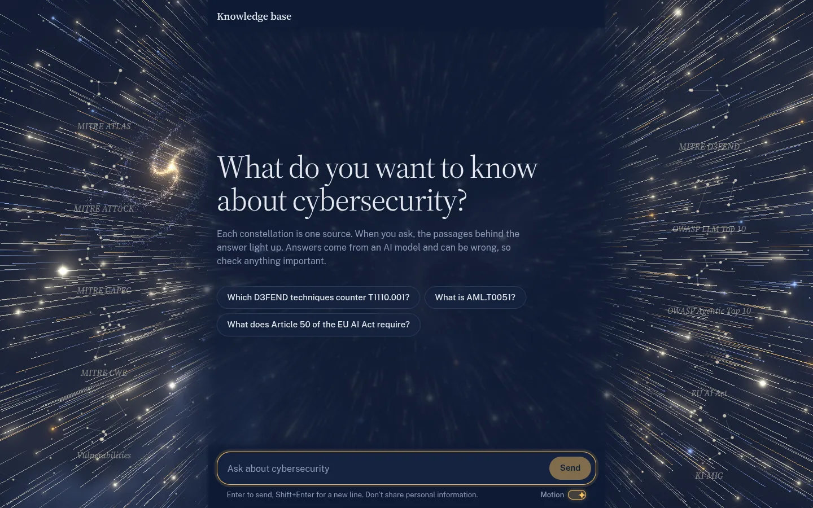
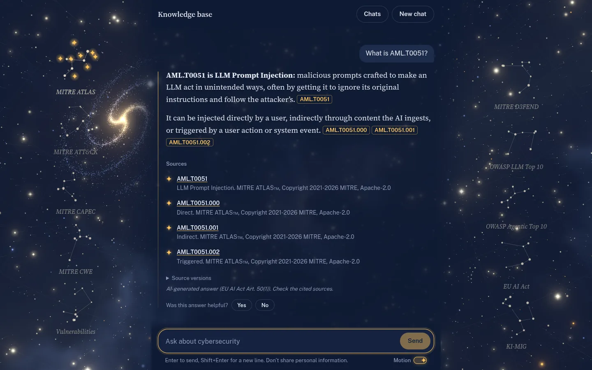
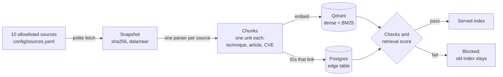
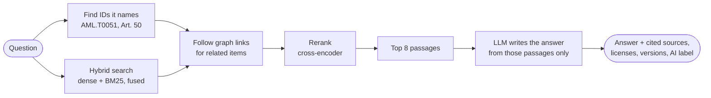
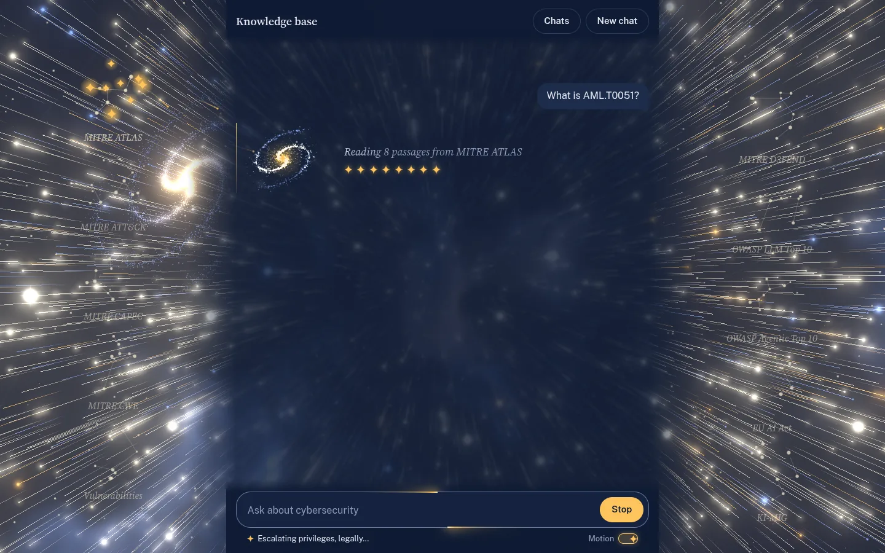

# rag-stack

[](https://github.com/chrysogonus/rag-stack/actions/workflows/ci.yml)


**A self-hosted chatbot for cybersecurity research that answers only from sources it can cite.**
It specializes in attacks against AI systems and in EU and German AI law. Every claim carries its
exact ID (an ATT&CK technique, a CWE weakness, an AI Act article, a CVE), and legal text is
quoted verbatim in English or German.

<picture>
  <source media="(prefers-color-scheme: light)" srcset="docs/images/welcome-light.webp">
  
</picture>

## Why use it instead of a general chatbot?

- 🗓️ **Fresh.** Sources are re-fetched every week (`make schedule`). New CVEs, ATLAS releases and amended laws are
  in the index, even when they are newer than the model's training data.
- 🔖 **Citable.** Answers name exact IDs and link to them. Legal text is quoted word for word,
  never paraphrased from memory. When the sources don't cover a question, the chatbot says so
  rather than guessing.
- 🔗 **Connected.** The chatbot follows links between sources. For example, it can go from an
  ATT&CK technique to the D3FEND countermeasures against it, or from a CWE weakness to its CAPEC
  attack patterns and to the CVEs that exploit it.



### Try asking

| Question | What it shows |
|---|---|
| What is AML.T0051? | Exact ID lookup (MITRE ATLAS) |
| Which D3FEND techniques counter T1110.001? | A join from ATT&CK to D3FEND |
| Which CAPEC attack patterns relate to CWE-89 SQL injection? | A join from CWE to CAPEC |
| What does Article 50 of the EU AI Act require? | Verbatim legal text |
| Wofür ist die BaFin nach § 2 Abs. 3 KI-MIG zuständig? | German law, answered in German |

## How it works

**1. Building the knowledge base** (`make refresh`, weekly):



Each source is snapshotted and split into its native units, so a chunk is exactly one technique,
one paragraph of a law or one advisory. Links between IDs (a technique and its mitigations, a CWE
and its CAPEC patterns) go into a graph table. A new index is served only if its checks pass and its
retrieval scores don't drop below the old index's.

**2. Answering a question:**



The question's IDs are looked up directly. Keyword and semantic search find the rest, and graph
links add related items when the question asks for them. A reranker keeps the 8 best passages.
The model answers only from those passages, and retrieved text is treated as data, never as
instructions. Each answer ends with its sources, their licenses and versions, and an
AI-generated label (EU AI Act Art. 50(1)).



## What's inside

About 18,700 chunks from ten openly licensed sources:

| Source | What it gives you | Version indexed | Chunks | License |
|---|---|---|---|---|
| MITRE ATLAS | Attacks on AI systems: tactics, techniques, mitigations, case studies | the latest release (2026.09) | 408 | Apache-2.0 |
| MITRE ATT&CK (Enterprise, Mobile, ICS) | Adversary techniques, groups, software | 20.0 | 3,440 | ATT&CK terms of use |
| MITRE CAPEC | Attack patterns | 3.9 | 841 | CAPEC terms of use |
| MITRE CWE | Software and hardware weaknesses | 4.20 | 1,646 | CWE terms of use |
| MITRE D3FEND | Countermeasures, mapped to ATT&CK | 1.6.0 | 288 | D3FEND terms of use |
| OWASP Top 10 for LLM Applications 2026 | LLM risks | `2026/final`, pinned commit | 63 | CC BY-SA 4.0 |
| OWASP Top 10 for Agentic Applications 2026 | AI-agent risks | PDF of 2025-12-09 | 44 | CC BY-SA 4.0 |
| EU AI Act (EN, DE) | Articles, annexes, recitals | consolidated 02024R1689-20260727, recitals from the OJ | 2,121 | © EU, Decision 2011/833/EU |
| KI-MIG | The German AI Act implementation law (BGBl. 2026 I Nr. 223) | gesetze-im-internet.de XML | 78 | § 5 UrhG |
| Vulnerabilities | The whole CISA KEV catalog, GitHub-reviewed critical and high advisories and every AI-package advisory of the last 24 months, with EPSS scores | daily snapshot (KEV, GitHub Advisory Database, OSV, NVD, EPSS) | 9,795 | CC0 / CC BY 4.0 / public domain / EPSS free use |

Pinned versions live in [`config/sources.yaml`](config/sources.yaml), and nothing else is
ingested. Attribution for every source is in [NOTICE.md](NOTICE.md).

## Does it work?

The chatbot is scored on 212 reviewed questions: 152 held out for testing, 60 for tuning. The
comparison is a general chatbot on the same model that can search the web. An LLM judge from
another model family scores the answers.

| Held-out test set (n=152) | General chatbot | rag-stack |
|---|---|---|
| Correctness | 0.70 | **0.89** |
| Citation precision | 0.48 | **0.86** |
| Says "I can't answer" when it should | 0.86 | **0.99** |
| Right passage among the 8 retrieved (recall) | — | **0.98** |
| Faithful to its sources | — | **0.96** |

Per-category numbers with 95% intervals are in the
[eval report](evals/datasets/ai_security/report.md).

## Quickstart

**You need:** Linux or WSL2, Docker, [uv](https://docs.astral.sh/uv/), Node.js 22, and an LLM.
The LLM can be the OpenAI or Anthropic API, a local Ollama or vLLM, or any Chat Completions
server. An NVIDIA GPU is optional.

```bash
make install                 # 1. Python and web dependencies; creates .env
$EDITOR .env                 # 2. pick your LLM provider (see below)
make services                # 3. start Postgres and Qdrant
make ingest SOURCE=all       # 4. fetch and chunk the sources ...
make index                   #    ... and embed them (models download once)
make up                      # 5. API on :8000 and the chat UI at http://localhost:5173
```

**Choosing the LLM.** `.env` starts out pointing at a personal subscription gateway on
`127.0.0.1:11435`. Unless you run one, switch the active block to one of the others listed in
the file:

- **OpenAI:** `LLM_PROVIDER=openai`, `LLM_MODEL=gpt-6-luna`, `LLM_API_KEY=sk-...`
- **Anthropic:** `LLM_PROVIDER=anthropic`, `LLM_MODEL=claude-sonnet-5-5`, `LLM_API_KEY=sk-ant-...`
- **Ollama:** `LLM_PROVIDER=openai-compatible`, `LLM_BASE_URL=http://127.0.0.1:11434/v1`, `LLM_MODEL=llama3.3`

Replace all five lines of the block, so that no `LLM_BASE_URL` is left over from the old one.

**The first ingest is slow without tokens.** The `vulns` source makes about 130 requests to
GitHub's advisory API and one NVD request per AI-package CVE. Without `GITHUB_TOKEN` in `.env`,
GitHub allows 60 requests an hour, so the first ingest takes over two hours. Without
`NVD_API_KEY`, NVD allows 5 requests per 30 seconds. Responses are cached for a day. Both
are free.

Try it from the terminal with `make ask Q="Which ATLAS mitigations address AML.T0051?"`, and stop
everything with `make down`. Stored conversations and the index are kept.

<details>
<summary><b>Everyday commands</b></summary>

`make` lists every command. The ones you'll use most:

```bash
make refresh      # ingest, check, build and score a new index; serve it if it passes [FORCE=1]
make schedule     # run `make refresh` weekly (systemd user timer, Sunday 03:00); `make unschedule`
make rollback     # serve the previous index again (a second rollback undoes it)
make status       # what is running, the last refresh and the next one
make logs         # follow the API and web UI logs (.run/)
make restart      # stop everything and start it again; `make restart-api` for the API only
make ci           # the CI pipeline, run locally
```

Deleting every stored conversation is a manual step: `make down && docker compose down -v`.

</details>

<details>
<summary><b>Evaluating changes</b></summary>

```bash
make eval                # paid: asks and judges only the questions whose inputs changed -> report.md
make evals               # free check of the saved results against thresholds.yaml (fails if any are stale)
make eval-retrieval      # retrieval only, no LLM: tune on the dev split, confirm with SPLIT=test
make eval-units          # retrieval checks generated from the corpus: IDs, titles, edges (N=50 per source)
make eval-draft SOURCE=atlas CATEGORY=paraphrase N=5   # draft new questions for review -> drafts.jsonl
make eval-labels         # sample 40 answers to label yourself; then `make eval-agreement` scores the judge
```

`make eval FULL=1` asks every question again, and `FRESH=1` asks the baseline again too.

The eval needs a judge and, optionally, a baseline chatbot: see `EVAL_JUDGE_*` and
`EVAL_BASELINE_*` in `.env.example`. The judge should come from another model family than the
chatbot.

</details>

<details>
<summary><b>GPU models (optional)</b></summary>

With an NVIDIA GPU, embeddings and reranking run on two vLLM services (`docker compose` profile
`gpu`): Qwen3-Embedding-4B and Qwen3-Reranker-0.6B, both fp8. Put this into `.env`, then run
`make refresh`. A new embedding model rebuilds the whole index, scored against the old one.

```bash
COMPOSE_PROFILES=gpu
EMBEDDING_PROVIDER=vllm
EMBEDDING_MODEL=Qwen/Qwen3-Embedding-4B
EMBEDDING_BASE_URL=http://127.0.0.1:8001/v1
RERANKER_PROVIDER=vllm
RERANKER_MODEL=Qwen/Qwen3-Reranker-0.6B
RERANKER_BASE_URL=http://127.0.0.1:8002/v1
RERANK_MIN_SCORE=0.005
```

Together they take about 8 GB of VRAM. `EMBEDDINGS_GPU_SHARE` and `RERANKER_GPU_SHARE` set each
one's share of the card, and vLLM won't start unless that much is free. The API, `make refresh`
and the evals then need both services, and other GPU work slows retrieval down. To roll back
after the switch with `make rollback`, put the old settings back in `.env` first, because
queries are embedded with the configured model.

</details>

<details>
<summary><b>Tracing and ratings</b></summary>

`make tracing` starts a self-hosted Langfuse at http://localhost:3000 (the login is in
`docker-compose.yml`). Uncomment the `LANGFUSE_*` lines in `.env` to send it one trace per chat
turn, covering retrieval stages, the model and tokens. Readers' Yes/No ratings become scores on
those traces. Without tracing, ratings are refused (503).

</details>

<details>
<summary><b>API</b></summary>

The chat UI uses three endpoints. The client picks the thread ID, a UUID.

| Endpoint | What it does |
|---|---|
| `GET /api/threads/{id}/messages` | The thread's messages |
| `POST /api/threads/{id}/messages` with `{"content": "..."}` | Streams the answer as server-sent events: `sources`, then `delta` chunks, then `done` (or `error`) |
| `POST /api/threads/{id}/feedback` with `{"message": n, "helpful": true}` | Rates an answer (204) |

Users are public and anonymous, so every request is capped (`.env`):

- an input that is too long or empty gets 422;
- a thread that is full gets 409;
- going over the per-client rate limit or the daily token budget gets 429.

Behind a reverse proxy, start uvicorn with `--proxy-headers --forwarded-allow-ips=<proxy IP>`
so these limits apply per user rather than per proxy.

</details>

## Tests

| Layer | Command | Needs |
|-------|---------|-------|
| Unit | `make test` | nothing (fixtures in `tests/fixtures/`, in-memory Qdrant, fake models) |
| AI (evals) | `make eval` (paid: ~2 calls per question whose inputs changed; ~425 with `FULL=1`, ~850 with `FULL=1 FRESH=1`), then `make evals` | LLM access, an indexed knowledge base; `make evals` checks the saved results (~5 min of retrieval, 1 call) and fails if any question is stale |
| End-to-end | `make e2e` | LLM access, embedding models (it starts Postgres and Qdrant); the rating test also `make tracing` (skipped without `LANGFUSE_*`) |
| Web | `make web-check` | nothing |

`make check-all` runs CI, one paid eval, the AI tests and e2e: the definition of done.

## Project map

```
src/rag_stack/    Python backend
  ingestion/        fetch, snapshot and parse each source
  retrieval/        Qdrant index, ID detection, hybrid search, graph, rerank
  agent/            the LangGraph agent: retrieve -> generate, prompts, answer footer
  llm/              chat, embedding and reranker adapters (OpenAI, Anthropic, any compatible server; fastembed, vLLM)
  api/              FastAPI: chat over SSE, ratings, rate limits
  db/               Postgres: conversations, edge table, migrations
  evals/            golden-set harness, judge calibration, question drafting
web/              chat UI (Vite, React, three.js)
config/           source allowlist with pinned versions
evals/datasets/   golden questions, thresholds, reports, run history
tests/            unit, ai (real LLM), e2e
deploy/           systemd timer for the weekly refresh, vLLM reranker template
```

**Read next:**

- [docs/HOW_IT_WORKS.md](docs/HOW_IT_WORKS.md): a plain-language tour in pictures, also usable
  as the outline for a 5-minute talk.
- [docs/PLAN.md](docs/PLAN.md): the design, the measurements behind each choice, and the
  roadmap toward general cybersecurity research.
- [docs/OPEN_QUESTIONS.md](docs/OPEN_QUESTIONS.md): what is still unresolved.
- [AGENTS.md](AGENTS.md): guidelines for contributors and coding agents.
- [NOTICE.md](NOTICE.md): attribution and licenses.
