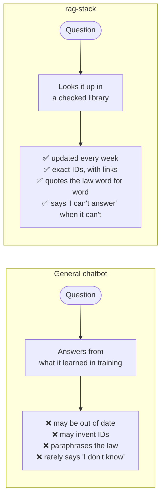
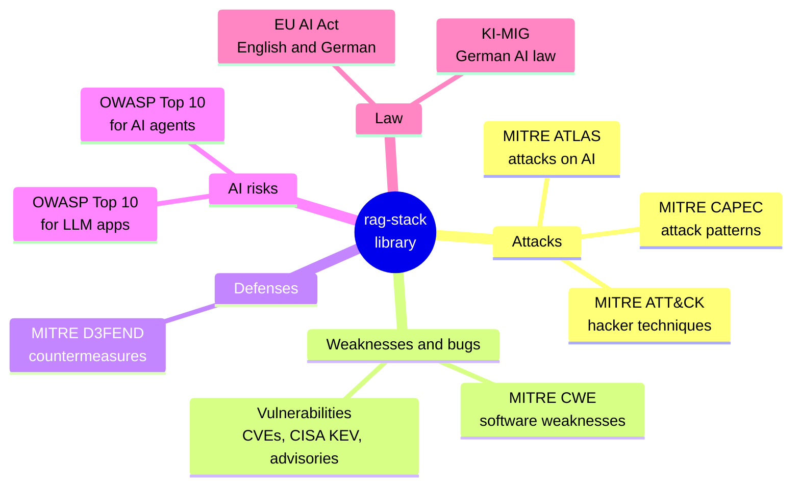
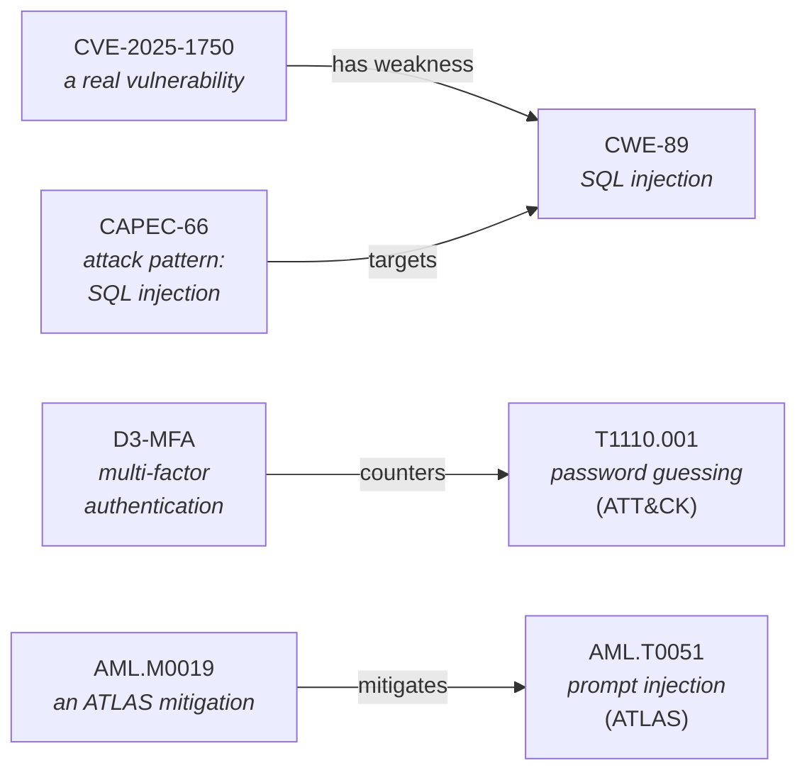
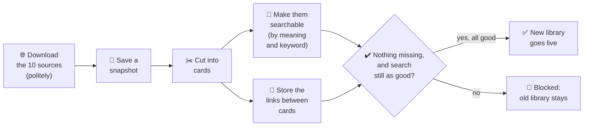
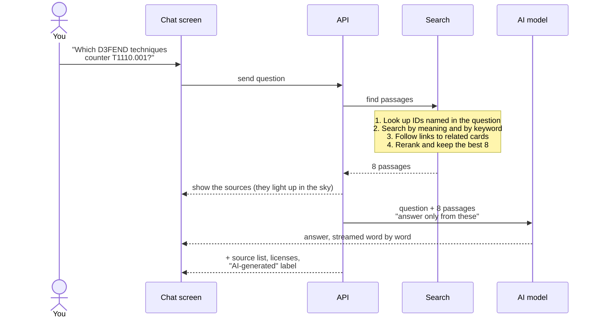
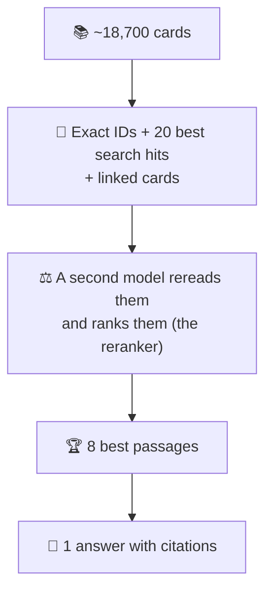
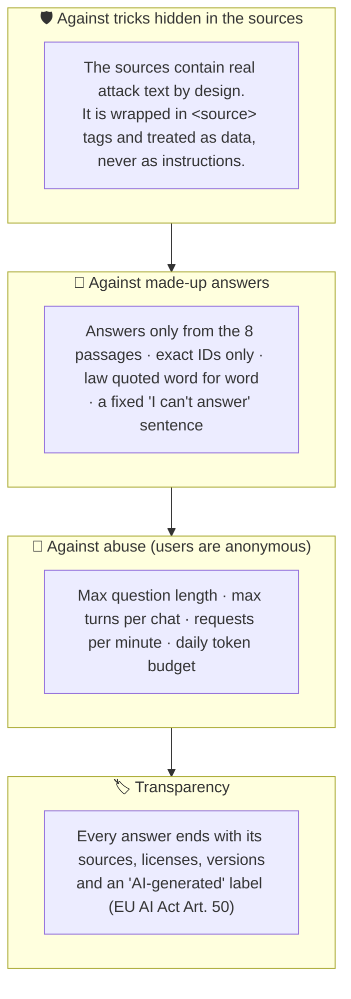
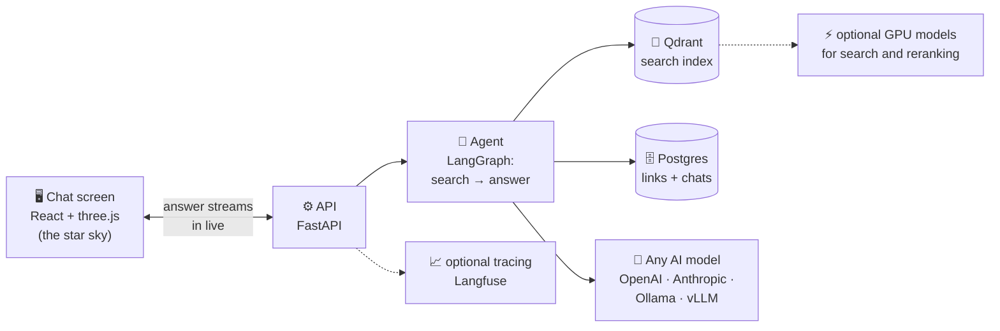

# How rag-stack works, in pictures

A plain-language tour of rag-stack, written as the outline for a 5-minute talk. Each section
covers one slide: a headline, a picture, a few bullets, and a **🎤 Say** line you can read aloud.
For setup and commands, see the [README](../README.md).

## The 5-minute plan

| # | Section | Time |
|---|---|---|
| 1 | [The idea in one sentence](#1-the-idea-in-one-sentence) | 0:00 – 0:30 |
| 2 | [Why not just use a general chatbot?](#2-why-not-just-use-a-general-chatbot) | 0:30 – 1:00 |
| 3 | [What's in the library](#3-whats-in-the-library) | 1:00 – 1:30 |
| 4 | [The sources are connected](#4-the-sources-are-connected) | 1:30 – 2:00 |
| 5 | [Step 1: building the library](#5-step-1-building-the-library-every-week) | 2:00 – 2:30 |
| 6 | [Step 2: answering a question](#6-step-2-answering-a-question) | 2:30 – 3:30 |
| 7 | [Built to stay safe](#7-built-to-stay-safe) | 3:30 – 4:00 |
| 8 | [Does it work?](#8-does-it-work) | 4:00 – 4:30 |
| 9 | [The tech in one picture](#9-the-tech-in-one-picture) | backup slide |
| 10 | [Takeaways and demo](#10-takeaways-and-demo) | 4:30 – 5:00 |

---

## 1. The idea in one sentence

**rag-stack is a chatbot for AI security and AI law that answers only from sources it can cite.**

- It runs on your own machine ("self-hosted"), not as someone else's cloud service.
- Its topics are attacks on AI systems, security weaknesses and vulnerabilities, and the EU and
  German AI laws.
- In the chat screen, each constellation in the sky stands for one source.

> 🎤 **Say:** "Think of a research assistant that never answers from memory. It first looks
> things up in a trusted library, and then shows you exactly where each fact comes from."

---

## 2. Why not just use a general chatbot?

**A general chatbot answers from memory. rag-stack looks things up first.**

The three promises:

- 🗓️ **Fresh:** the library is rebuilt every week, so new vulnerabilities and amended laws are
  in it, even if they are newer than the AI model.
- 🔖 **Citable:** every claim names its exact ID (like `AML.T0051` or `AI Act Art. 50`) and links
  to it.
- 🔗 **Connected:** it can follow links from one source to another (more in section 4).

> 🎤 **Say:** "A general chatbot is like a smart friend who remembers a lot but can't show you
> the book. rag-stack always brings the book."

---

## 3. What's in the library

**Ten trusted, openly licensed sources, cut into about 18,700 "index cards".**

- Each source is split into its natural pieces: one attack technique, one article of a law, or
  one vulnerability per card. We call these pieces **chunks**.
- Only sources on a fixed allowlist get in (`config/sources.yaml`), and each one is pinned to an
  exact version.
- Every chunk keeps its ID, version, link and license, so the chatbot can always cite it.

> 🎤 **Say:** "The library has ten sources: who attacks, how, which weaknesses they use, how to
> defend, and what the law says. Each one is cut into small cards that each carry their own ID."

---

## 4. The sources are connected

**The cards point at each other, and the chatbot can follow those links.**

- The sources already name each other: a CVE says which weakness it has, D3FEND says which attack
  each defense counters.
- rag-stack collects these links into a table in a database (Postgres).
- When a question asks about related things ("Which defenses counter…?"), the chatbot also
  fetches the linked cards.

> 🎤 **Say:** "This is where a general chatbot struggles. Ask 'which defenses stop password
> guessing?', and rag-stack follows the link from the attack to its countermeasures."

---

## 5. Step 1: building the library (every week)

**Once a week the library is rebuilt, and a new version is only used if it passes its checks.**

- **Download politely:** respect each website's rules and speed limits, and cache the
  responses.
- **Searchable by meaning:** each card is turned into a list of numbers (an **embedding**) that
  captures what it is about. Cards with a similar meaning get similar numbers.
- **Safety gate:** if a source loses more than 10% of its cards or IDs, or a set of test searches
  scores noticeably worse than before, the new version is blocked. One command (`make rollback`) brings back the
  previous version.

> 🎤 **Say:** "It works like a careful librarian. Every week the new editions come in, but they
> only go on the shelf after a check shows that nothing went missing."

---

## 6. Step 2: answering a question

**Find the 8 best passages, then let the AI write an answer from those passages only.**

How 18,700 cards become one answer:

- **Two kinds of search together** (**hybrid search**): meaning search finds "password
  guessing" when you write "brute force", and keyword search finds exact terms and IDs.
- **If nothing relevant is found,** it answers "I can't answer that from the indexed sources."
  It doesn't even ask the AI model, so it can't make something up.
- **Follow-up questions** keep the context: "and which of those need hardware?" still knows
  what "those" refers to.

> 🎤 **Say:** "Your question goes to search first, not to the AI. Search narrows 18,700 cards
> down to the 8 best. The AI may only use those 8, and every claim links back to one of them."

---

## 7. Built to stay safe

**Several layers keep both the answers and the service trustworthy.**

- **Prompt injection** means hiding instructions in text so that an AI obeys them. The library
  is full of real examples (it is a security library), so the chatbot is told, and tested, never
  to follow them.
- The limits protect the budget: anyone can use the chat, so nobody can run up the bill.

> 🎤 **Say:** "Our library literally contains attack instructions, because that's the topic. So
> the system treats everything it reads as data, never as orders, and we test that with real
> attacks."

---

## 8. Does it work?

**On 152 test questions, rag-stack beats a general chatbot that can search the web.**

```mermaid
xychart-beta
    title "Held-out test set (152 questions), higher is better"
    x-axis ["Correct answers", "Correct citations", "Knows its limits"]
    y-axis "Score (0 to 1)" 0 --> 1
    bar [0.89, 0.86, 0.99]
    bar [0.70, 0.48, 0.86]
```

| | General chatbot (front, shorter bar) | rag-stack (back, taller bar) |
|---|---|---|
| Correct answers | 0.70 | **0.89** |
| Correct citations | 0.48 | **0.86** |
| Knows its limits: says "I can't answer" when it should | 0.86 | **0.99** |

- The right passage is among the 8 retrieved for **98%** of the questions.
- **96%** of the answers stick to their sources.
- The comparison uses the same AI model. The general chatbot may search the web; rag-stack uses its
  library.
- The answers are graded by a judge model from another AI company, so the model isn't grading its
  own homework. Details: [eval report](../evals/datasets/ai_security/report.md).

> 🎤 **Say:** "We measured it. Citations are almost twice as precise, and it nearly always
> admits when it doesn't know, instead of guessing."

---

## 9. The tech in one picture

**Standard open-source parts, and you choose the AI model.**

Words to know:

| Word | In plain language |
|---|---|
| **RAG** (retrieval-augmented generation) | Look things up first, then write the answer from what was found |
| **Chunk** | One card of the library: one technique, one article, one vulnerability |
| **Embedding** | A list of numbers that captures a text's meaning, so similar texts can be found |
| **Hybrid search** | Searching by meaning and by keyword at the same time |
| **Reranker** | A second model that rereads the candidates and puts the best on top |
| **Agent** | The small program that runs the steps: search, then answer |

> 🎤 **Say (if asked):** "It's all standard open-source building blocks, it runs on one machine,
> and you can plug in OpenAI, Anthropic, or a fully local model."

---

## 10. Takeaways and demo

**Three things to remember:**

1. 🗓️ **Fresh:** the library is rebuilt and checked every week.
2. 🔖 **Citable:** every claim has an exact ID and a link, and the law is quoted word for word.
3. 🔗 **Connected:** it follows links from attacks to weaknesses, defenses and laws.

**Live demo questions** (start the app with `make up`, then open http://localhost:5173):

| Ask this | It shows |
|---|---|
| What is AML.T0051? | Exact ID lookup |
| Which D3FEND techniques counter T1110.001? | Following links between sources |
| What does Article 50 of the EU AI Act require? | Law quoted word for word |
| Wofür ist die BaFin nach § 2 Abs. 3 KI-MIG zuständig? | German question, German answer |

> 🎤 **Say:** "Fresh, citable, connected. Let me show you."

---

## Want more detail?

- [README](../README.md): setup, commands and the full source table
- [docs/PLAN.md](PLAN.md): the design and the measurements behind each choice
- [Eval report](../evals/datasets/ai_security/report.md): all scores, by category
- [NOTICE.md](../NOTICE.md): attribution and licenses
